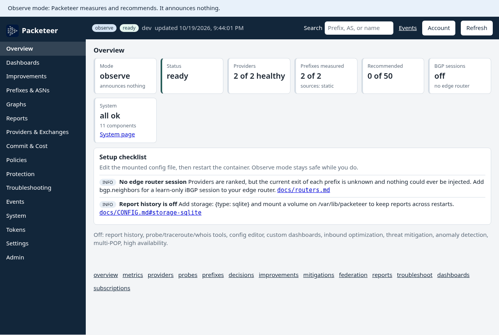
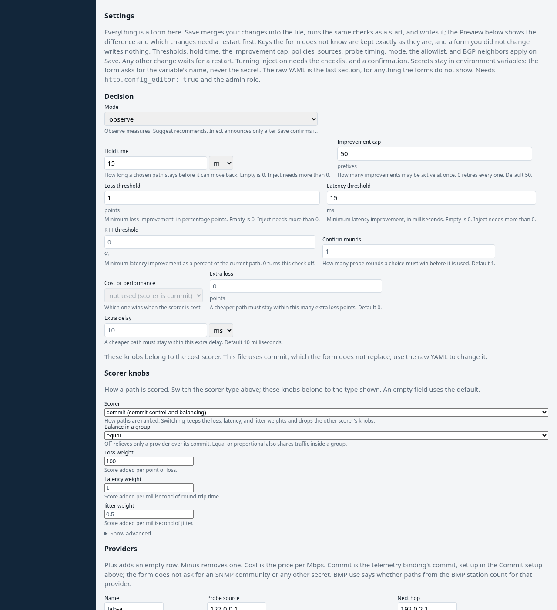
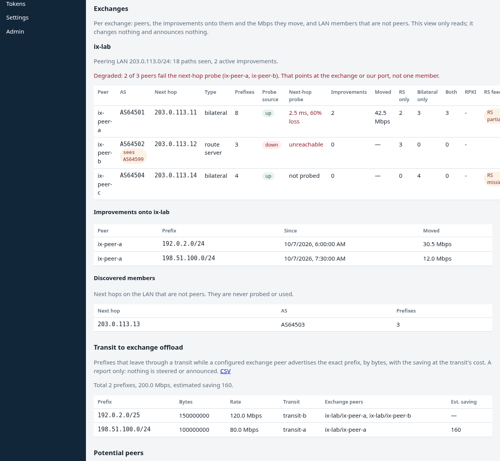
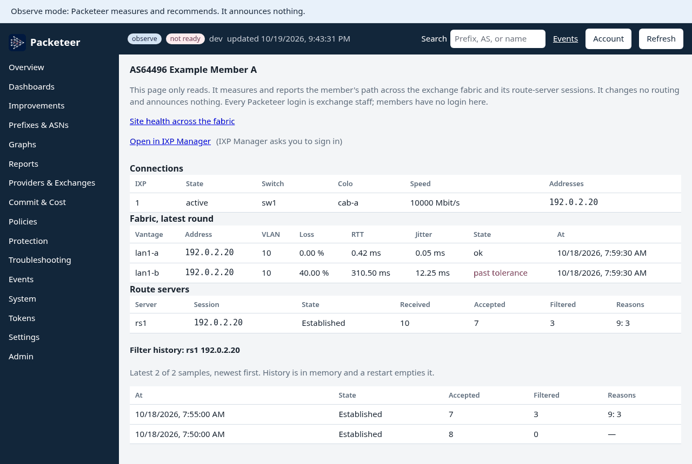

<p align="center"></p>

# Packeteer

Open-source BGP path performance controller for multi-homed networks. One container, a mounted config file, and the edge router you already run.

Packeteer sits off to the side of the edge. It probes each upstream from that upstream's source address, scores loss, latency, and jitter, and learns today's exit from iBGP. In the default mode it only reports. If you later turn injection on, it advertises a better exit back to the edge for prefixes you allowlisted. If Packeteer stops, those routes go away and the router's own BGP decision stands.

The feature matrix is [docs/FEATURES.md](docs/FEATURES.md).

## What it does

- **Measure.** Probes (`icmp`, `tcp`, `udp`, `https`) from each provider's `source_ip`, targets from static lists, NetFlow, IPFIX, sFlow, a mirror port, traceroute, VIPs, and outage lists, scores loss, latency, and jitter. The per-provider path check (#150) marks a provider down when its probes do not leave through its `next_hop`. Providers and exchange peers may share one `source_ip` with a distinct `fwmark` or `dscp`, and `packeteer -pbr <format>` prints the Linux or router policy-routing config without applying it (#157).
- **Learn.** An iBGP session, or BMP with add-path, gives the router's own exits. An opt-in `rpki` block reads an RTR server and labels each learned path `valid`, `invalid`, `notfound`, or `unknown`; `avoid_invalid` refuses a new steer onto an invalid path (#158).
- **Recommend or steer.** `observe` and `suggest` announce nothing. `inject` advertises an allowlisted, learned prefix with your community and `no-export`. The opt-in `synthesize` block (off by default, lab-proven only) also announces measured sub-ranges that are NOT in the learned RIB; read the warning in [docs/CONFIG.md](docs/CONFIG.md#synthesize) first. Cost and commit control, 95th-percentile telemetry over SNMP, inbound optimization, RTBH and FlowSpec mitigation, anomaly detection, flap quarantine, leak watch, HA, and multi-POP federation are listed in [docs/FEATURES.md](docs/FEATURES.md).
- **Internet exchanges, as an edge network.** An `exchanges` block adds peers, LAN health probes, route-server vs bilateral views, transit-to-IX offload and potential-peers reports, and a shared port (`exchanges[].port`: capacity, commit, flat `port_cost`; the commit and cost scorers plan no move past it).
- **Internet exchanges, as the operator.** An `ixp` block is observe-only. `members` imports the IX-F member list (#161), `vantages` and `fabric` measure member LAN loss, RTT, and jitter (#162), `routeservers` polls Birdseye with GET only and flags new origins, more-specific bursts, and blackhole routes (#164, #165), `correlate` separates a fabric problem from a member problem (#163), and `core` with the top-level `federation` block joins one instance per site (#167). Member pages are at `/ixp/member/{asn}` (#166). Nothing is announced.
- **Events.** Notifier events carry a plain headline, a link to what to do, and a details fold. `provider.down`, `provider.degraded`, and `bgp.session_not_established` come from measurements (#347, [docs/EVENTS.md](docs/EVENTS.md)).
- **Herd (opt-in).** Share what your probes measure with a few other operators ([below](#herd-opt-in)).
- **Onboarding.** `scripts/install.sh` starts the stock image in observe, the Settings page runs blocking preflight checks with a fix for each, `packeteer -snippet <vendor>` prints router config, and `packeteer -pbr linux -apply` shows a diff before it sets up host policy routing. Settings and the API refuse to turn injection on until the checks pass ([docs/onboarding.md](docs/onboarding.md)).
- **Settings forms.** The Settings page edits most blocks of the config with guided inputs (federation and the inbound and mitigation inject and exec plugins stay YAML), a Preview diff, and the raw YAML under Advanced ([docs/ui.md](docs/ui.md#settings-form)).



The overview in observe mode, from the lab config with fixed probe results on documentation addresses.



Settings: guided forms over the mounted file. Save merges the form into the file text, runs the start checks, and writes it. Preview shows the diff first.



Exchange view for an edge network's own peering, on lab fixture data (documentation prefixes and ASNs).



The IXP member page for an exchange operator: fabric by vantage, route-server session, and filter history. It only reads.

## Safety model

Read this before you change `mode`.

- The default mode is `observe`. The file in this repository stays `observe`. `suggest` probes and recommends, and announces nothing.
- An `ixp: {}` block is an exchange operator, not an edge that injects. It refuses `mode: inject`, `announcer`, `mitigation`, `inbound`, `synthesize`, and `more_specific`, and it does not need `bgp.neighbors` ([design](docs/design/ixp.md)). Optional `ixp.members` (`type: ixf`) imports the IX-F member list and announces nothing. Optional `ixp.vantages` and `ixp.fabric` (`type: icmp`) record member LAN loss, RTT, and jitter from those vantages and announce nothing. Optional `ixp.routeservers` (`type: birdseye`) polls Birdseye with GET only, keeps per-session history and alerts, and with `route_signals` flags new origins and more-specific bursts, and counts blackhole routes. Optional `ixp.correlate` (`type: topology`) groups the fabric probes by switch, colo, and core bundle and alerts on a fabric problem or a member problem.
- `inject` is a separate config: `mode: inject`, a non-empty allowlist, `packeteer_community`, `local_pref`, a positive `hold_time`, positive loss and latency thresholds, an iBGP neighbor, and `announcer.type: gobgp`.
- Packeteer announces a prefix only when that exact prefix is in the RIB it learned from the router. It does not invent a more-specific. A config that sets `more_specific_bits` is rejected. The optional `more_specific` block (off by default) also announces the more-specifics a neighbor already advertises inside an improvement's prefix, under a route cap ([design](docs/design/more-specific.md)).
- Active improvements are capped (`max_improvements`, default 50).
- A new improvement waits for a real gain (the thresholds) and then stays up for at least `hold_time`.
- Every injected route carries your community and the well-known `no-export` community. The edge must accept only that community from Packeteer, and must reject it on every eBGP session. `no-export` is the second layer.
- Packeteer withdraws its routes on shutdown, when a probe source dies, when measurements go stale (including when a probe round never finishes), when every iBGP session drops, and when a prefix the router was still advertising leaves the RIB. Graceful restart is never enabled. A kill is covered by the BGP hold timer (Packeteer proposes 90 seconds; a shorter timer from the router wins).
- This repository uses documentation prefixes (RFC 5737, RFC 3849) and the private ASN 64512. Keep real prefixes and real ASNs out of commits, issues, and logs you paste in public.

Threat model: [docs/THREAT_MODEL.md](docs/THREAT_MODEL.md). Agent rules: [AGENTS.md](AGENTS.md).

## Install

The image is `ghcr.io/grandarcher/packeteer`, linux/amd64 and linux/arm64. It runs as root inside the container so it can open raw ICMP sockets and, if you ask it to, TCP port 179. Give it `NET_RAW` and `NET_ADMIN`. It needs host networking: probes must leave from each provider's source address, the iBGP session must reach the router, and a flow collector binds host UDP ports.

| Tag | What it is |
|---|---|
| `0.8.0` | This release. Pin this. |
| `latest` | The same release, updated when a release tag is published. |
| `edge` | The build from `main`. The Compose file in this repo uses it. |

**Step by step: [docs/quickstart.md](docs/quickstart.md).** It goes from an empty directory to a running instance in observe, with a first run on loopback, `docker run` and Compose, and the stop. CI runs every command on that page against the image built from the same commit.

The short version, pinned to 0.8.0. Take the example config from the same tag as the image: the file on `main` can carry keys a release does not know yet, and unknown keys refuse startup. For `:edge`, use `main` in both places.

```sh
IMAGE=ghcr.io/grandarcher/packeteer:0.8.0
curl -fsSLo config.yaml https://raw.githubusercontent.com/GrandArcher/Packeteer/v0.8.0/config.example.yaml
# Edit providers and source IPs. Leave mode: observe.
mkdir -p plugins

docker run --rm \
  -v "$PWD/config.yaml:/etc/packeteer/config.yaml:ro" \
  "$IMAGE" -check

docker run -d --name packeteer --network host \
  --cap-add NET_RAW --cap-add NET_ADMIN \
  --restart unless-stopped \
  -v "$PWD/config.yaml:/etc/packeteer/config.yaml:ro" \
  -v "$PWD/plugins:/etc/packeteer/plugins:ro" \
  -v packeteer-data:/var/lib/packeteer \
  "$IMAGE"
```

`-check` prints `mode: observe` and `check: ok (no probes sent, no BGP sessions opened)`. The image does not contain your config. It does contain the example at `/etc/packeteer/config.example.yaml`:

```sh
docker run --rm -e PACKETEER_CONFIG=/etc/packeteer/config.example.yaml \
  ghcr.io/grandarcher/packeteer:0.8.0 -check
```

The default config path inside the container is `/etc/packeteer/config.yaml` (`PACKETEER_CONFIG`, or `-config`).

The dashboard and API require sign-in (#328). On the first start the log prints a generated admin password once (`docker logs packeteer 2>&1 | grep 'generated admin password'`; it is also in `/var/lib/packeteer/first-run-admin-password`), and the sign-in page makes you choose a new one. Set `PACKETEER_ADMIN_PASSWORD` to pick it yourself. Details and the opt-out: [docs/auth.md](docs/auth.md#first-run).

Without `NET_RAW`, or where ICMP is filtered, the probe falls back to TCP port 443 (the log shows `prober=tcp`). With the example config (providers in 192.0.2.0/24) the signed-in admin is sent to the setup wizard after changing the generated password, with no config edit: the settings form, wizard, and config editor are on until a config is saved or setup is skipped (and until the next restart), then off unless you set `http.config_editor: true`. A config with a real provider keeps them off, and `false` keeps them off (sign-in is on by default; [docs/ui.md](docs/ui.md), [docs/auth.md](docs/auth.md)). Every environment variable: [docs/ENV.md](docs/ENV.md).

The `packeteer-data` volume keeps report history (`storage: {type: sqlite}`, file `/var/lib/packeteer/packeteer.db`) across container restarts and upgrades, and the open billing period of SNMP 95th-percentile samples when telemetry is configured. Without the volume, reports and that window start empty after the container is recreated. Leave out `storage` to turn history off; the probe and decision loop does not depend on it, and the 95th window then lives in memory only. Sign-in on by default (no `auth.enabled`, no `PACKETEER_HTTP_USER`) adds `sqlite` when `storage` is left out.

[docker-compose.yml](docker-compose.yml) runs the same container with Compose: host networking, the two capabilities, the mounts, and `restart: unless-stopped` ([quickstart, step 5](docs/quickstart.md#5-or-run-it-with-compose)). Its `image` line uses `:edge`; change it to `ghcr.io/grandarcher/packeteer:0.8.0` to pin. There is no `ports:` map: with host networking, `http.listen` is already an address on the host. Stop with `docker compose stop -t 30` (see [Rollback](#rollback)).

## Minimum config

The smallest file that validates, probes, and serves the dashboard is below. Addresses are documentation ranges. Replace `source_ip` and `next_hop` with addresses that exist on your host and on your transits. Leave `mode: observe`.

```yaml
mode: observe
asn: 64512
router_id: 192.0.2.10
providers:
  - name: transit-a
    source_ip: 192.0.2.11
    next_hop: 192.0.2.1
  - name: transit-b
    source_ip: 192.0.2.12
    next_hop: 192.0.2.2
probe:
  interval: 30s
  timeout: 2s
  packets: 10
sources:
  - type: static
    config:
      targets:
        - prefix: 198.51.100.0/24
          host: 198.51.100.1
http:
  listen: "127.0.0.1:8080"
```

One provider passes validation. Two is the useful case: Packeteer compares the same destination out of each. The file above omits `thresholds`, so both deltas stay `0` and no improvement is recorded. [config.example.yaml](config.example.yaml) sets `min_loss_delta_pct: 1` and `min_rtt_delta_ms: 15` and comments the rest of the keys.

Every key, default, and bound is in [docs/CONFIG.md](docs/CONFIG.md).

## Host policy routing

A probe toward a destination is sent with that provider's `source_ip`. The host routing table has to send packets from that address out of the matching transit. Otherwise every provider measures the same path. If `source_ip` is not configured on the host, that provider is marked down and left out.

The container uses `--network host`, so the rules live on the host. Full steps, reverse-path filtering, IPv6, and the MikroTik equivalent: [docs/policy-routing.md](docs/policy-routing.md). The addresses in that guide are a separate subnet per transit. The minimum config above uses one documentation subnet so the YAML stays short; on a real host, `source_ip` and `next_hop` have to be the addresses in the rules.

```sh
ip addr add 192.0.2.11/24 dev eth1
ip addr add 198.51.100.11/24 dev eth2
echo "101 transit-a" >> /etc/iproute2/rt_tables
echo "102 transit-b" >> /etc/iproute2/rt_tables
ip route add default via 192.0.2.1 dev eth1 table transit-a
ip route add default via 198.51.100.1 dev eth2 table transit-b
ip rule add from 192.0.2.11 lookup transit-a priority 1001
ip rule add from 198.51.100.11 lookup transit-b priority 1002
ip route get 203.0.113.1 from 192.0.2.11
ip route get 203.0.113.1 from 198.51.100.11
```

Use the `source_ip` and `next_hop` values from your config. Make the rules persistent with the host's network config. On the probe interfaces, loose reverse-path filtering avoids dropping replies that arrive on a different interface than the default route:

```sh
sysctl -w net.ipv4.conf.all.rp_filter=2
```

## Router setup

You can run observe with no BGP session. Packeteer then ranks paths and does not know which exit the router uses, so it will not recommend a move.

To learn current exits, peer iBGP, same ASN, between the router and Packeteer. In observe and suggest, Packeteer announces nothing on that session. Before inject, install both filters:

1. From Packeteer, accept only routes that carry `packeteer_community`.
2. Toward every eBGP neighbor, reject that community.

Leave graceful restart off on the session. Guides:

- [docs/adopting.md](docs/adopting.md) - moving from or alongside an existing route optimizer: concepts mapped to config and an observe-first cut-over plan
- [docs/roi.md](docs/roi.md) - worksheet to estimate the return: transit cost, commit relief, and measured gain
- [docs/walkthrough.md](docs/walkthrough.md) - observe, suggest, inject, and roll back on a simulated FRR edge, then the same steps on a real one. CI runs every command
- [docs/mikrotik.md](docs/mikrotik.md) - RouterOS 7 iBGP, filters, Traffic Flow, port mirroring, and SNMP
- [docs/frr.md](docs/frr.md) - FRR; the walkthrough lab runs this configuration in CI
- [docs/junos.md](docs/junos.md) - Juniper Junos
- [docs/cisco.md](docs/cisco.md) - Cisco IOS and IOS-XE
- [docs/routers.md](docs/routers.md) - what every router guide shares, what happens when the native path disappears, and exchange peers
- [docs/route-reflector.md](docs/route-reflector.md) - several edge routers, per-router provider reachability, route reflectors, Internet exchange peers, and SIGHUP reload of neighbors, thresholds, policies, and sources
- [docs/multi-pop.md](docs/multi-pop.md) - several POPs (routing domains) federated over mutual TLS: inter-DC RTT in the path cost, global commit across POPs, and the central view. Lab-proven only
- [docs/leak-watch.md](docs/leak-watch.md) - how Packeteer keeps its routes inside your AS: the rails, and `leak_watch`, which withdraws and holds out a route seen outside the AS. Lab-proven only
- [docs/precedence.md](docs/precedence.md) - which surface owns a prefix when mitigation, inbound, outbound, a leak hold, flap quarantine, and HA all want it, how the shared cap is spent, and which test proves each pair
- [docs/policy-routing.md](docs/policy-routing.md) - probe sources behind the router
- [docs/inventory.md](docs/inventory.md) - read providers, next hops, and communities from NetBox or Peering Manager, with `config plan`, `diff`, and `apply`
- [docs/registry.md](docs/registry.md) - find stale or missing IRR route objects, RPKI ROAs, as-set members, and PeeringDB records, with the exact fix; an admin-confirmed push for RIPE and PeeringDB, off by default
- [docs/vrf.md](docs/vrf.md) - transit sessions in an internet VRF, probe routing per VRF, and partial-table or default-only providers
- [docs/reordering.md](docs/reordering.md) - packet reordering per provider path (RFC 4737) with the shipped TWAMP-Light reflector, the ICMP estimate and its caveat, and the optional score weight
- [docs/ui.md](docs/ui.md) - config editor and first-run wizard, custom dashboards, email report subscriptions, and improvement weights

A flow export (NetFlow, IPFIX, or sFlow) is optional. It only adds probe targets. It does not inject routes. With host networking the collector's UDP port is a host port; firewall it to the exporter.

Optional probers, target sources, and probe tuning (`udp`, `traceroute`, `vip`, `outage`, retries, dispersion): [docs/operating.md](docs/operating.md#probing-options).

## Start in observe

1. Mount the minimum config, or `config.example.yaml`, with `mode: observe`.
2. `docker run ... -check` (or `go run ./cmd/controller -check -config config.yaml` from a checkout).
3. Start the container.
4. Open the dashboard at `http://127.0.0.1:8080/` when `http.listen` is the default. Until the instance is fully set up it shows a setup checklist: what to add to the mounted file next (sources, `bgp.neighbors`, storage) and what looks broken (a provider whose probes all fail, no iBGP session). Logs show one line per probe (`loss_pct`, `rtt_avg`, `jitter`) and, once a session is up, `bgp session` state and a periodic `rib ready=true`.

```sh
curl -fsS http://127.0.0.1:8080/healthz
curl -fsS http://127.0.0.1:8080/readyz
curl -fsS http://127.0.0.1:8080/api/providers
curl -fsS http://127.0.0.1:8080/metrics
```

`/healthz` stays up while the process is serving. `/readyz` returns 503 until startup finishes, and until an iBGP session is up when `bgp.neighbors` is set. No neighbors means ready as soon as startup finishes.

Stay here until the numbers match what you expect from each transit. A `probe failed` line whose error contains `probe source address unavailable` means that `source_ip` is missing on the host or the policy route is wrong. A successful probe with high `loss_pct` is a measurement of that transit.

## Suggest, then inject

`mode: suggest` recommends and announces nothing. `mode: inject` needs the allowlist, `packeteer_community`, `local_pref`, `hold_time`, non-zero thresholds, an iBGP neighbor, `announcer.type: gobgp`, and the router filters from the guides. The full list, what to check on the router, and the lab run: [docs/operating.md](docs/operating.md#suggest-then-inject) and [docs/walkthrough.md](docs/walkthrough.md).

## Rollback

Stopping the container withdraws every Packeteer route. Give it 30 seconds; Docker's default 10 races the withdraw.

```sh
docker stop -t 30 packeteer
# or, from the Compose directory:
docker compose stop -t 30
```

`docker kill` does not withdraw: the routes stay until the router's hold timer expires, and the Compose restart policy starts the container again. Switching back to `mode: observe` and restarting also withdraws. HA pairs, the other automatic withdraws, and the show commands to confirm: [docs/operating.md](docs/operating.md#rollback).

## Dashboard, API, and metrics

`http.listen` defaults to `127.0.0.1:8080`. Set it to `""`, or set `PACKETEER_HTTP_LISTEN=off`, to disable it. Any other value of `PACKETEER_HTTP_LISTEN` replaces `http.listen`. The image exposes port 8080 as documentation; with host networking you do not publish it.

The server is read-only (GET and HEAD), except on-demand maintenance windows (`POST` and `DELETE` on `/api/maintenance`), which need basic auth or an operator and can only exclude providers, threat mitigation rules (`POST` and `DELETE` on `/api/mitigations`), which need basic auth or an operator and announce only when `mitigation.mode` is `inject`, the troubleshooting tools (`POST` on `/api/troubleshoot/probe`, `traceroute`, and `whois`), which measure or look up and change nothing, and `/api/troubleshoot/optimize`, which only queues a learned prefix for measuring, with `upgrade.enabled`, an admin's confirmed upgrade or rollback of the Packeteer binary (`POST` on `/api/upgrade/check`, `apply`, and `rollback`; the controller withdraws every route first, [docs/ui.md](docs/ui.md#upgrade-from-the-ui)), and, with `auth`, users and API tokens. Every change is written to the audit log and sent to the notifiers. The dashboard loads no remote assets and refreshes every 5 seconds.

Every endpoint, with its body and the role it needs, is in [docs/API.md](docs/API.md).
Sign-in (`auth`) is on unless `auth.enabled: false` is written or both `PACKETEER_HTTP_USER` and `PACKETEER_HTTP_PASSWORD` are set; those two keep the single basic-auth account. Setting only one of them refuses to start. The password is not read from the config file and is not written to the log.

`auth` (#32, on by default since #328) gives users with roles (`viewer`, `operator`, `admin`) kept in the storage plugin, API tokens for scripts and Prometheus, an audit log of every change (stored, on `/api/audit`, and sent to the notifiers as `audit.recorded`), optional OIDC single sign-on, and `http.allow_from` to restrict client addresses. The first admin comes from `PACKETEER_ADMIN_PASSWORD`, or a generated password that must be changed at first sign-in. Guide: [docs/auth.md](docs/auth.md). Rollback: `auth.enabled: false` and restart; the log then warns and the UI shows a banner.

The Prometheus metric names are listed in [docs/API.md](docs/API.md#metrics).

Scrape `http://127.0.0.1:8080/metrics` on the host with an API token (`Authorization: Bearer`, [docs/auth.md](docs/auth.md#api-tokens)) or the basic-auth account.

`PACKETEER_LOG_LEVEL=debug` adds detail. `log.format: json` or `PACKETEER_LOG_FORMAT=json` switches the log to JSON.

## Plugins

Almost every part of Packeteer is a plugin selected by `type` in the config. Unknown types and unknown keys inside a plugin `config` block refuse startup. The built-ins, by kind:

- **Probers:** `icmp`, `tcp`, `udp`, `https`, `fixed` (labs only).
- **Target sources:** `static`, `flow` (NetFlow, IPFIX, sFlow), `traceroute`, `vip`, `outage`, `span` (mirror port or pcap; needs `NET_RAW`).
- **Route feeds:** rib_source `bmp` (BMP and add-path from the routers).
- **Scorers:** `weighted` (default), `commit`, `cost`.
- **Policies:** `rules` (ignore, allow, deny, static, or VIP by prefix, origin ASN, or country) and `maintenance`.
- **Announcers:** `gobgp` for outbound, plus the `gobgp` inbound and mitigation announcers ([inbound.md](docs/inbound.md), [mitigation.md](docs/mitigation.md)).
- **Notifiers:** `webhook` (JSON, Slack, Teams, PagerDuty, templates), `smtp`, `snmptrap` (traps and informs), `syslog` ([EVENTS.md](docs/EVENTS.md), [docs/monitoring.md](docs/monitoring.md)).
- **Exporters:** `kafka`, `nats`, `otlp`, `influxdb`, `ipfix`, `snmpagent` (a read-only SNMP agent with a MIB for any NMS) (events, decisions, flows tagged with the chosen provider, and metric snapshots, [docs/export.md](docs/export.md)).
- **Telemetry:** `snmp` and `fixed` (labs only).
- **Storage:** `sqlite` (report history, users, audit log, dashboards).
- **Detection and safety:** detector `baseline` (flow anomaly detection, [anomaly.md](docs/anomaly.md)) and leak_source `bmp` and `rislive` ([leak-watch.md](docs/leak-watch.md)).
- **Clusters:** elector `lease` (active/standby, [ha.md](docs/ha.md)) and federation `mtls` (several POPs, [multi-pop.md](docs/multi-pop.md)).
- **Sign-in and lookups:** sso `oidc` ([auth.md](docs/auth.md)) and whois `rdap` (troubleshooting).

Only the announcers and the plugins that feed route decisions can put a route on the session, and those are compiled in only. An `exec` plugin is any executable you mount at `/etc/packeteer/plugins`; it works in the stock image as a prober, a target source, or a notifier, speaking one JSON request and one JSON reply per call. A `grpc` plugin is the same kind of program kept running over gRPC, for probers that hold state.

Interfaces, the exec protocol, and a shell example: [docs/PLUGINS.md](docs/PLUGINS.md). To write one: [docs/PLUGIN_AUTHORING.md](docs/PLUGIN_AUTHORING.md). Keys: [docs/CONFIG.md](docs/CONFIG.md).

## Herd (opt-in)

Off by default. A `herd:` block lets a few operators share what their probes measure: each member stores its own per-round records, serves them signed over mutual TLS pinned to per-node keys, and pulls its peers' records. It is advisory. Herd never announces, and no herd data is read by `Decide`, a scorer, a policy, or the announcer. If herd fails once running, probing and BGP carry on as if it were off.

A record holds the time, packets sent, reply RTTs, loss, RTT min, average, max and jitter, your declared country, the probe method, the origin ASN, and your provider's ASN. It holds no provider names, probed host addresses, SNMP or usage data, config, or free text. A prefix is shared only when it is in your learned RIB view, is not a default or private route, is not in `herd.share.exclude`, is not yours or your customers', and a target source listed in `herd.share.sources` produced it. Peers come from `herd.peers`, and optionally from a public hub list that is a seed list, not an identity check.

```yaml
herd:
  enabled: true
  vantage: {country: US}
  peers:
    - url: https://192.0.2.30:9444
      key: ed25519:<base64 of the 32-byte public key>
  hub:
    url: https://hub.example.net/herd.json
```

Herd needs `storage` type `sqlite` and `bgp.neighbors`. Details: [docs/herd.md](docs/herd.md), [docs/herd-hub.md](docs/herd-hub.md), [CONFIG.md](docs/CONFIG.md#herd), and the [design](docs/design/herd.md). The hub repository `GrandArcher/packeteer-herd` is not live unless it exists when the release is tagged; the examples use `example.net` and the list built into the image is empty. Herd has no dashboard page; read it at `GET /api/herd`.

## FAQ

Symptoms, log lines, and fixes: [docs/troubleshooting.md](docs/troubleshooting.md).

**The container exits immediately.** The log line `refusing to start` is a config or plugin error. Run `-check`. Unknown YAML keys, a missing provider, and an inject file that omits the allowlist or the community all fail closed.

**The dashboard has no prefixes.** Add a `sources` entry. Prefixes that sit only in the RIB are not listed. A failed probe is a source address, a missing `NET_RAW`, or a filter in the path. ICMP falls back to TCP port 443 when ICMP cannot run.

**`/readyz` stays 503.** Neighbors are configured and no session is established. Check ASN, reachability, and whether Packeteer should connect out (`listen_port` 0) or wait (`passive` plus `listen_port`). Filters do not stop the session from coming up; they stop routes.

**Nothing is recommended.** Thresholds are still `0`, the prefix is not in the RIB, the RIB next hop matches no provider, the gain is inside the thresholds (including `min_rtt_delta_pct` when it is set), `confirm_rounds` has not been met (`confirming` in `/api/decisions`; the default 1 does not wait), `thresholds.require_evidence` is on and the current or the better path has no evidence beyond ICMP (`require_evidence:` in the reason), or the provider is excluded.

**Inject is on and the router shows no route.** The prefix is not in the learned RIB, it is outside the allowlist, the cap is full, or the router rejected the community. Packeteer will not announce a prefix it has not learned.

**Will a stop leak routes to transit?** The route is withdrawn and tagged `no-export`. The eBGP community filter in the router guides is what you control if `no-export` is stripped. After `docker stop -t 30`, the community lookup on the router should be empty.

**Can I put my config in this git repo?** Keep it on the host you mount into the container. Do not commit real prefixes, ASNs, SNMP communities, or hook tokens.

## Features

Status as of v0.8.0, capability rows per milestone and how many are done, from the summary in [docs/FEATURES.md](docs/FEATURES.md#summary):

| Milestone | Rows | Done |
|---|---|---|
| v0.1 | 24 | 23 |
| v0.2 | 25 | 24 |
| v0.3 | 17 | 17 |
| v0.4 | 13 | 10 |
| v0.6 | 9 | 7 |
| v0.7 | 3 | 3 |
| v0.8 | 19 | 15 |
| Won't do | 2 | - |
| **Total** | 112 | 99 |

v0.1 is the outbound loop: probes, static and flow targets, an iBGP RIB, scoring with hysteresis, optional injection, the read-only UI and API, the container, and the FRR lab. v0.2 adds cost and commit control, SNMP, policies, alerts, and reports. v0.3 adds inbound optimization, BMP and add-path, multiple routers and IX, RTBH/FlowSpec mitigation, transit classification, and capped more-specific injection, all lab-proven. v0.4 adds multi-POP federation, active/standby HA and backup, RBAC/SSO/audit, flow-baseline anomaly detection that mitigates only on explicit rules, and the remaining UI rows. v0.5 is hardening on that matrix: dashboard clarity and a first-run checklist, CI-tested install and walkthrough docs, load and soak budgets, a MikroTik CHR lab in CI, and a scheduled router interop matrix. Field feedback from real observe-mode deployments (#54) is still open. v0.6 closes the gaps from the 2026-10-07 review of prefix selection, measurement, and the UI, adds flap quarantine, live apply, scale budgets up to multi-million path tables, upgrade from the UI, and a failure-mode e2e matrix. v0.7 adds exchange (IX) visibility for an edge network: an exchange view, IX LAN health probes, route-server vs bilateral prefix views, offload and potential-peers reports, dashboard widgets, Commit & Cost, Reports, search, System, and maintenance pages, and link-outs.

v0.8 (this release) is about Internet exchanges and shared measurements: IXP observe-only mode with IX-F import, fabric probes, Birdseye route-server history and signals, fabric incident correlation, member pages, and multi-site health; RPKI origin labels; probe multiplexing with a PBR generator and a probe-path check; a shared IX port; PeeringDB lookup; BMP exchange peer monitoring; events from measured provider health; settings forms for most blocks of the config (the raw YAML covers the rest); and the opt-in herd with its hub. Some rows are partial: the shared IX port, potential peers, exchange autoconfig, the settings form, and herd (phase 1 and the hub; the hub has unit and integration tests only, not lab-proven). The rows say what is missing. No row is field-proven yet (#54), and none of it relaxes the safety rules above.

## Upgrades

Pulling a newer image and recreating the container is the plain upgrade. Your config and the `packeteer-data` volume carry over.

The Settings page can also upgrade in place (#196). It is off by default. It needs `upgrade.enabled: true`, the release public key in `upgrade.public_key` ([CONFIG.md](docs/CONFIG.md#upgrade)), an admin login (auth or basic auth), and the `packeteer-data` volume to keep the new version across restarts. The public key is printed in the [v0.6.0 release notes](https://github.com/GrandArcher/Packeteer/releases/tag/v0.6.0). Every route is withdrawn before the switch, and a release whose signature or checksum does not match is refused. Details: [docs/ui.md](docs/ui.md#upgrade-from-the-ui).

### From 0.7 to 0.8

- **Sign-in is now on for every install, upgrades included (#328).** A config without an `auth` block now requires sign-in, and `storage` defaults to `sqlite` to keep users. Prometheus scrapers and API clients without a token, for example on `/metrics`, get `401` until you give them an API token ([auth.md](docs/auth.md)). On first start without `PACKETEER_ADMIN_PASSWORD`, a one-time admin password is generated ([auth.md](docs/auth.md#first-run)). To keep the old open behavior, add this to the config and restart:

  ```yaml
  auth:
    enabled: false
  ```

- No config key was removed or renamed since 0.7. Run `docker run --rm -v "$PWD/config.yaml:/etc/packeteer/config.yaml:ro" ghcr.io/grandarcher/packeteer:0.8.0 -check` first.
- Provider health labels on the dashboard now follow measured loss: no reply or loss at `probe.down_loss_pct` is `down`, loss at `probe.degraded_loss_pct` is `degraded` (#343). They do not change a decision.
- The probe-path check (#150) is on by default. A provider whose probes do not leave through its `next_hop` is marked down with the reason `probe path mismatch`, for example one reached across another router. Set `path_check: false` on that provider or exchange peer, or `probe.path_check.enabled: false` for all ([CONFIG.md](docs/CONFIG.md#probepath_check)).
- New events reach every notifier that does not filter them: `provider.down`, `provider.degraded`, and `bgp.session_not_established` (#347). Limit them with the notifier's `events` and `min_severity` ([CONFIG.md](docs/CONFIG.md#notifier-filters-every-notifier)).
- Herd, `ixp`, and `rpki` are off unless you add the block.

## Roadmap and contributing

Questions, ideas, or just want to talk routing? Join the [Packeteer Discord](https://discord.gg/MWCCGw8Rq6).

- What is done, partial, and planned: [docs/FEATURES.md](docs/FEATURES.md) and the [milestones](https://github.com/GrandArcher/Packeteer/milestones).
- How to send a change: [CONTRIBUTING.md](CONTRIBUTING.md). Safety and doc rules for every change: [AGENTS.md](AGENTS.md).
- Writing a plugin: [docs/PLUGIN_AUTHORING.md](docs/PLUGIN_AUTHORING.md); plugins by other people: [docs/COMMUNITY_PLUGINS.md](docs/COMMUNITY_PLUGINS.md).
- Plugin roadmap: PeeringDB and IRR record checks ([#289](https://github.com/GrandArcher/Packeteer/issues/289)).

Bug reports and field reports from observe-mode deployments (#54) are the most useful contribution right now.

## Build from source

Go 1.26.

```sh
go build -o packeteer ./cmd/controller
./packeteer -check -config config.example.yaml
./packeteer -version
docker build -t packeteer .
```

`go test ./...`, `go vet ./...`, and an empty `gofmt -l .` are the local bar. BGP behavior is tested against the FRR lab in CI (`bash lab/e2e.sh`), not against a live edge. See [lab/README.md](lab/README.md). Memory, CPU, and flow-ingest budgets under a full-table-sized synthetic RIB are in [docs/performance.md](docs/performance.md); CI fails when one regresses.

## Layout

```
cmd/controller/     # entrypoint
internal/httpapi/   # health, metrics, JSON API, embedded dashboard
internal/probe/     # per-provider sourced measurements
internal/policy/    # score + hysteresis
internal/announce/  # inject-mode gate in front of the announcer plugin
internal/rib/       # learn-only iBGP view (embedded GoBGP)
internal/plugins/   # probers, target sources, scorer, announcer, notifier, telemetry
docs/CONFIG.md      # config reference
lab/                # FRR e2e lab (CI job e2e); lab/soak load and soak harness (CI job load)
```

## Support the project

Packeteer is free and open source. If it helps your network, you can chip in to cover development and lab costs through [PayPal](https://paypal.me/GrandArcher) or the **Sponsor** button at the top of this page.

## License

Apache-2.0. See [LICENSE](LICENSE).
